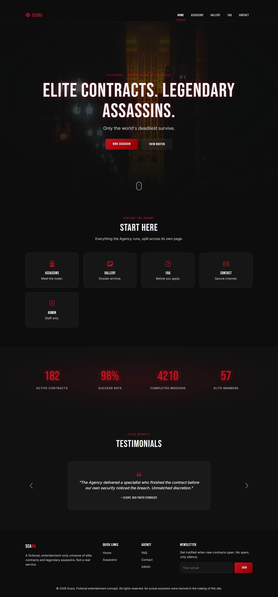
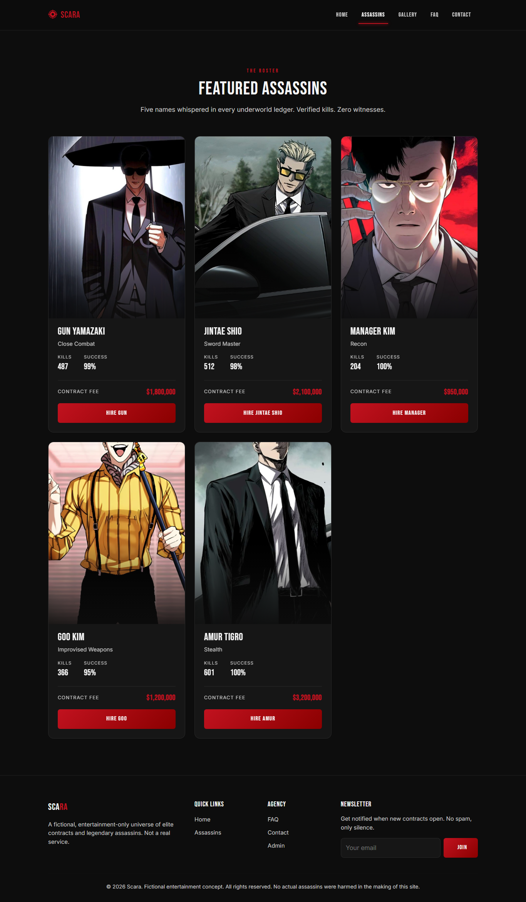
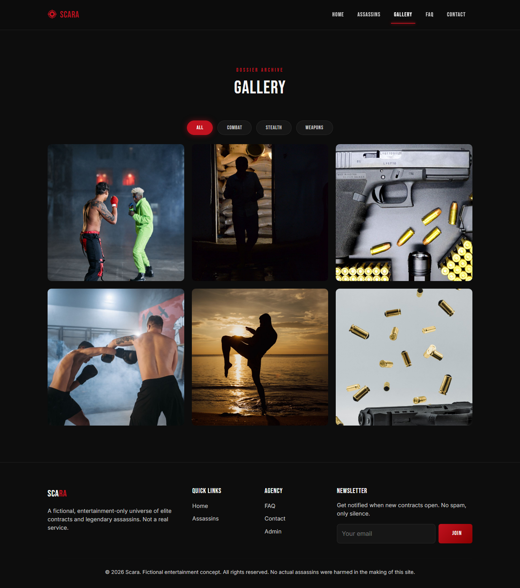
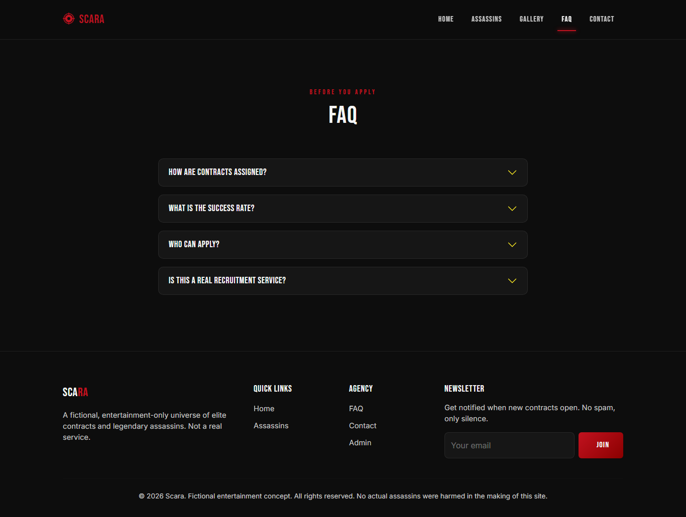
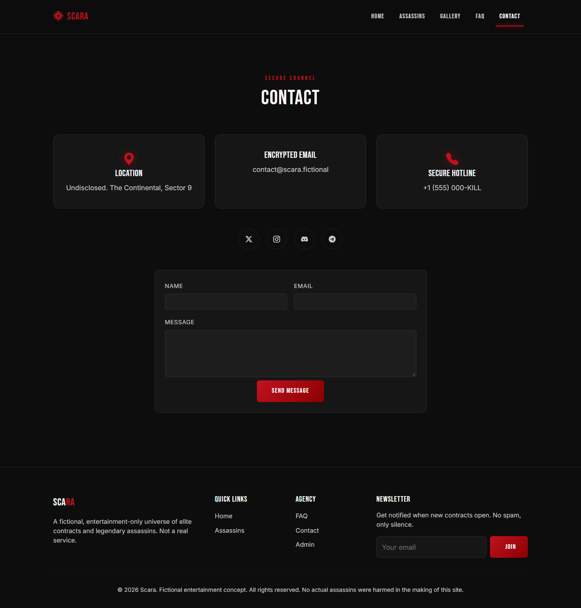
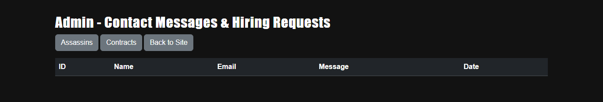
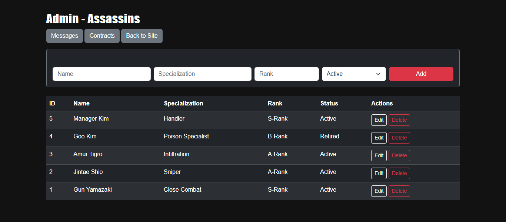
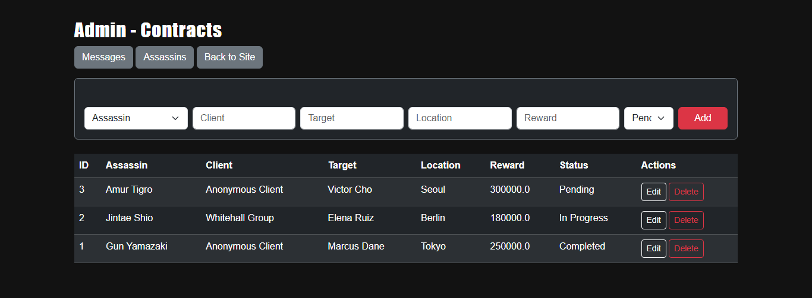

# Scara – Assassin Contract Agency (Advance Java Technology Project)

A fictional entertainment-themed web application for an assassin-for-hire agency. Visitors can browse the roster, gallery and FAQ and send a hiring request through the contact form. An admin area lets staff manage assassins, contracts and received messages.

> Course: 01CE0308 – Advance Java Technology, Marwadi University (Faculty of Engineering and Technology, Computer Engineering)

## Technologies and Tools

| Layer | Technology |
|---|---|
| Frontend | JSP, HTML5, CSS3, JavaScript, Bootstrap 5.3, Bootstrap Icons, Google Fonts |
| Backend | Java Servlets (Servlet 4.0 / `javax.servlet`), JDBC, DAO pattern |
| Database | MySQL / MariaDB (`mysql-connector-j-9.7.0`) |
| Server | Apache Tomcat 8.5+ (XAMPP Tomcat) |
| Tools | NetBeans IDE (Ant build), XAMPP, Git/GitHub |

## Features

- Home page with hero section, stats counters and testimonials slider, plus background music toggle
- **Assassins** roster page loaded from the database
- Image **gallery** and **FAQ** accordion
- **Contact / Hire** form – messages are stored in the `contact_messages` table (`ContactServlet`)
- **Admin – Messages**: view all contact/hiring requests (`admin.jsp`)
- **Admin – Assassins**: add, edit and delete assassins (`assassins-admin.jsp`, `AssassinServlet`, `AssassinDAO`)
- **Admin – Contracts**: add, edit and delete contracts linked to an assassin (`contracts-admin.jsp`, `ContractServlet`, `ContractDAO`)
- Responsive layout for desktop and mobile

## Project Structure

```
project/
├── src/java/            Java source (models, DAOs, servlets, DBConnection)
├── web/                 JSP pages, css/, js/, images/, audio/
│   └── WEB-INF/         web.xml and lib/mysql-connector-j-9.7.0.jar
├── database.sql         Database schema and sample data
├── build.xml, nbproject/  NetBeans / Ant project files
└── screenshots/         Application screenshots
```

## Database Setup

1. Start MySQL (XAMPP Control Panel → MySQL → Start).
2. Import the script:
   ```bash
   mysql -u root < database.sql
   ```
   or open phpMyAdmin → *Import* → choose `database.sql`.
3. This creates the database `scara_ajt` with the tables `assassins`, `contracts`, `contact_messages` and inserts sample records.
4. Connection settings are in `src/java/DBConnection.java` (default: `jdbc:mysql://localhost:3306/scara_ajt`, user `root`, empty password). Change them if your MySQL credentials differ.

## Installation and Execution

### Option A – NetBeans (recommended)
1. Install JDK 17+ , NetBeans and XAMPP (Tomcat + MySQL).
2. Open the `project` folder in NetBeans (*File → Open Project*), and register Tomcat as the server (*Services → Servers*).
3. Import the database as described above.
4. Right-click the project → **Run**. The app opens at `http://localhost:8080/project/`.

### Option B – Manual WAR deployment
1. Compile the sources and build the WAR (NetBeans *Clean and Build* creates `dist/project.war`).
2. Copy `project.war` into Tomcat's `webapps/` folder and start Tomcat.
3. Browse to `http://localhost:8080/project/`.

### Admin pages
`admin.jsp` (messages), `assassins-admin.jsp` and `contracts-admin.jsp` are linked from the Home page.

## Screenshots

| Home | Assassins |
|---|---|
|  |  |

| Gallery | FAQ |
|---|---|
|  |  |

| Contact | Admin – Messages |
|---|---|
|  |  |

| Admin – Assassins | Admin – Contracts |
|---|---|
|  |  |

## Links

- GitHub repository: https://github.com/prathamsoni146367/ajt-scara-project
- Deployed application (GitHub Pages static demo): https://impratham001.github.io/ajt-scara-project/
  - GitHub Pages serves static files only, so this demo shows all pages with the database content captured at build time; saving/editing/deleting data requires running the Java backend on Tomcat + MySQL as described above.

## Team

- 92610120005 – Brij Butani
- 92610120006 – Pratham Soni
- 92610120007 – Radhesh Bhayani
